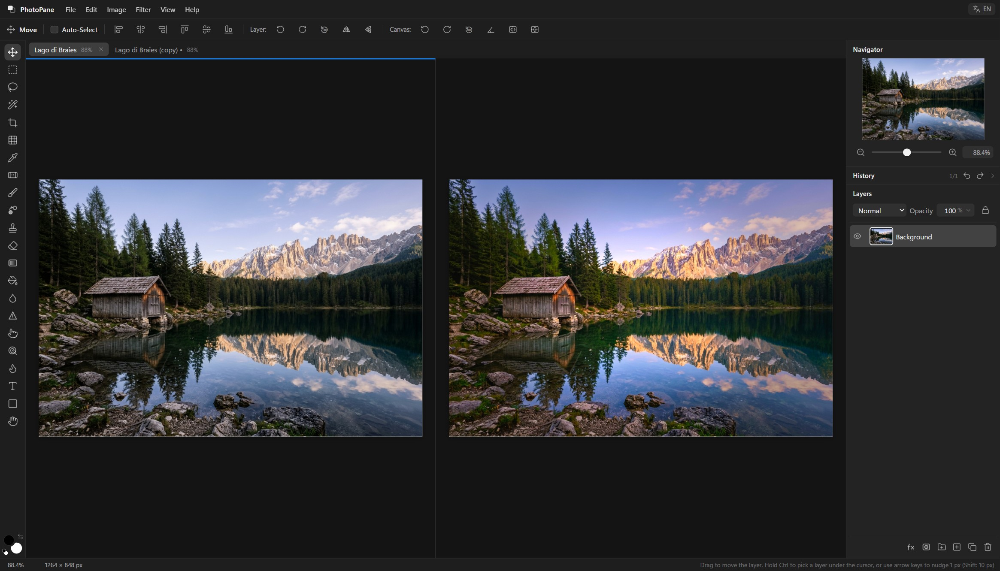
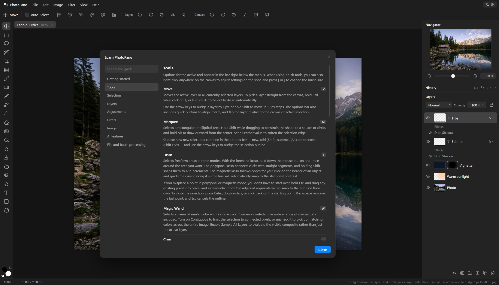

<p align="center">
  
</p>

<h1 align="center">PhotoPane</h1>

<p align="center">
  A lightweight, modern image editor for Windows, macOS, and Linux.<br>
  All the familiar tools, without the clutter.
</p>

<p align="center">
  <a href="https://github.com/sokoloff-rv/photopane/releases/latest"><b>Download</b></a> ·
  <a href="README.ru.md">Русская версия</a>
</p>


PhotoPane handles everything most people open a heavy photo editor for — fixing light and color, retouching, making clean cutouts, combining layers, and adding editable text — without the bloat. It opens layered Photoshop files, runs offline, and comes in at around an 18 MB download on Windows and macOS. Your images stay on your computer and are never uploaded unless you explicitly run a cloud AI tool with your own API key.

## Why PhotoPane

- **Lightweight and offline:** Roughly an 18 MB download on Windows and macOS, starts fast, opens layered `.psd` files, and needs no account or subscription.
- **Live GPU adjustment chains:** Keep multiple adjustment and filter windows open at the same time — they stack into a live pipeline with a Before / After split and render smoothly on your graphics card.
- **Local retouching and upscaling:** Content-Aware Fill and a built-in 2×/4× AI upscaler run directly on your machine with no cloud uploads required.
- **True side-by-side Compare:** Split the workspace into two independent copies of your document, each with its own full history, synced pan/zoom, and automatic scale matching after upscaling.
- **Optional, transparent AI:** Bring your own Stability AI or Topaz Labs keys only when you want them — PhotoPane validates limits before uploading, shows account balances and operation costs up front, and tracks local credit usage.

## What it can do

**Layers & typography.** Work freely with layer groups, layer masks, clipping masks, 17 blend modes, opacity, and locked transparency. Add live layer styles — drop shadow, stroke, bevel and emboss, color and gradient overlays — that update as you edit. Free Transform includes distortion and perspective, and text layers stay editable with system fonts and Google Fonts.

**Light and color.** A single **Adjust** window brings together light, color, skin tone, clarity, grain, and vignette — complete with an Auto button and custom presets. For finer control, open Levels, Curves, the HSL Mixer, or Toning. Every adjustment previews live as you move the sliders, and several windows can stay open at once.


**Retouching.** Remove distractions with the Spot Healing Brush, Clone Stamp, and local Content-Aware Fill — just select what you want gone and PhotoPane rebuilds the area from surrounding textures right on your computer. You also get Blur, Sharpen, Smudge, Dodge, Burn, and Color Replacement brushes.

**Filters.** Apply Gaussian, Motion, Radial, and Surface blur, or shape depth of field directly on the photo with Field Blur, Iris Blur, and Tilt-Shift with bokeh highlights. Unsharp Mask, Dehaze, Reduce Noise, Glow, Halftone, Emboss, 3D color LUTs (`.cube`), and more all support a Before / After split, with heavy filters accelerated on your GPU.


**Selections & crop.** Make precise cutouts with rectangular and elliptical marquees, freehand, polygonal, and magnetic lassos (with Ctrl+drag point tweaking), and the Magic Wand, then refine edges with feather, expand, contract, and smooth. Crop freely, lock to ratios or exact pixel sizes, straighten angled shots with Perspective Crop, or expand past the canvas edges and fill the new space with a solid color, local content-aware fill, or AI.

**Compare.** Split the workspace into two independent copies of your document with their full history intact. Step one version back or try a different edit and inspect both side by side with synced zoom and pan.



**Files & color profiles.** Open PNG, JPEG, WebP, GIF, BMP, AVIF, and PSD files. Save PSD with layers, masks, styles, and editable text, or export to JPEG, PNG, WebP, and PDF with a live file-size preview as you choose the quality. Batch-process folders or groups of files in one go, and work accurately across sRGB, Display P3, and Adobe RGB color profiles.

**Optional AI.** Upscale images 2× or 4× offline with a built-in local model, or connect Topaz Labs and Stability AI using your own API keys (PhotoPane picks the right Topaz model for your photo automatically). Remove backgrounds onto a non-destructive mask, select subjects, or extend images while cropping — with upfront size checks, key balances, per-operation cost previews, and local spending tracking.

**Learn as you go.** Open **Help → Learn PhotoPane** (`F1`) for a searchable, plain-language guide to every tool, adjustment, and filter in a floating window that stays beside your work.



The interface is available in English and Russian, with the keyboard shortcuts you already know from Photoshop.

## Download

Grab the latest release from the [Releases](https://github.com/sokoloff-rv/photopane/releases/latest) page:

| System | File |
| --- | --- |
| Windows 10 and 11 | `…-setup.exe` (installer) or `.msi` |
| macOS 11 and newer (Apple Silicon and Intel) | `.dmg` |
| Linux | `.deb`, `.rpm`, or `.AppImage` |

- **Windows:** The installer isn't code-signed yet, so Windows SmartScreen may show a *"Windows protected your PC"* prompt the first time you run it. Click **More info** and then **Run anyway** (only needed once).
- **macOS:** The app isn't notarized by Apple yet. On the first launch, open **System Settings → Privacy & Security** and click **Open Anyway** next to the notice for PhotoPane (only needed once).

## Privacy

PhotoPane requires no account and collects no telemetry or usage data. All your images are opened, edited, and saved locally on your computer. Google Fonts are downloaded only the first time you pick a font. Cloud AI features (Stability AI and Topaz Labs) send your active image using your own API key only when you explicitly start them; the keys themselves are stored only on your device.

<details>
<summary><b>Building from source</b></summary>

PhotoPane is written in plain TypeScript (no UI framework) using Canvas 2D, WebGL2 shaders, Web Workers, ONNX Runtime Web for local upscaling, and [Tauri 2](https://v2.tauri.app/) for the native desktop wrapper — which keeps the desktop download around 18 MB.

**Requirements:** Node.js 22+ (plus Rust 1.77+ and Tauri system dependencies for desktop builds).

```bash
npm install
npm run dev            # run the web version on http://localhost:5178
npm run desktop        # run the Tauri desktop app in dev mode
npm run desktop:build  # build native installers
```

</details>
