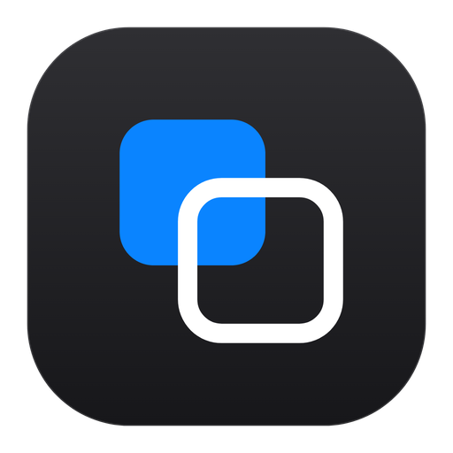
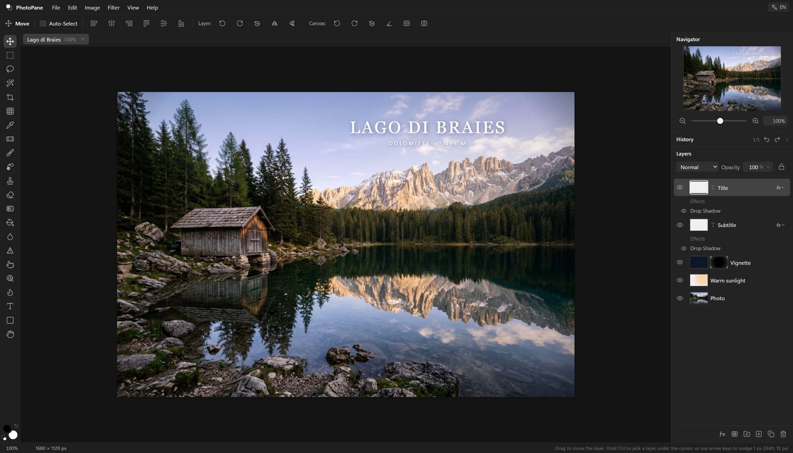
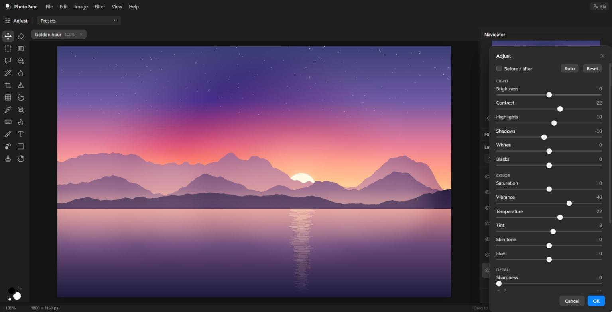
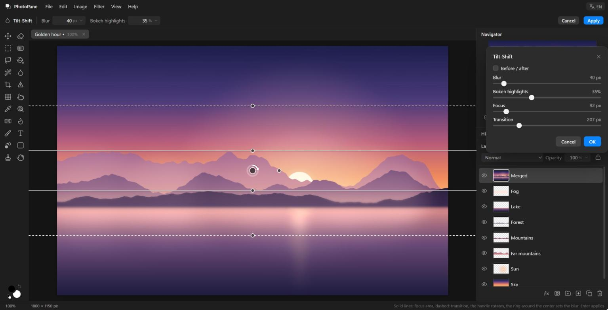

  

<h1 align="center">PhotoPane</h1>

  A lightweight, modern image editor for Windows, macOS and Linux. 
  The familiar tools — with one obvious way to do each thing.

  <a href="https://github.com/sokoloff-rv/photopane/releases/latest"><b>Download</b></a> ·
  <a href="README.ru.md">Русская версия</a>

PhotoPane does what most people open a big photo editor for — fixing light and colour, retouching, cutting out,
combining layers, adding text — without the weight and the clutter. It opens Photoshop files with their layers,
works offline, and is about an 18 MB download on Windows and macOS. Your pictures never leave your computer unless
you ask an AI service for help with your own key.

## What it can do

**Layers.** Groups, layer masks, clipping masks, 17 blend modes, opacity and locked transparency. Layer styles:
drop shadow, stroke, bevel and emboss, colour and gradient overlay. Free transform with distortion and perspective.
Text stays editable.

**Light and colour.** One Correction window for light, colour, skin tone, clarity, grain and vignette, with an Auto
button and your own presets — plus Levels, Curves, an HSL mixer and toning. Every adjustment shows its result on the
picture as you move the sliders, and several can be open at once.

**Retouching.** Spot healing brush, clone stamp and content-aware fill: select something you don't want and it is
rebuilt from the picture around it, right on your computer. Blur, sharpen and smudge brushes, dodge and burn, colour
replacement.

**Filters.** Gaussian, motion, radial and surface blur, and field, iris and tilt-shift blur with bokeh, adjusted with
handles right on the photo. Unsharp mask, dehaze, noise reduction, glow, halftone, emboss, colour LUTs (.cube) and
more, with a before/after split. Heavy work runs on the graphics card.

**Selections.** Rectangle and ellipse, freehand, polygonal and magnetic lasso, magic wand; feather, expand,
contract and smooth.

**Crop.** Ratios, exact sizes in pixels and your own presets, perspective crop. Take the frame past the edges and
the new area is filled with a colour, from the picture itself or by AI.

**Compare.** Split the window into two independent copies of the document — step one back in history or edit it
differently and see both side by side.

**Files.** Opens PNG, JPEG, WebP, GIF, BMP, AVIF and PSD. Saves PSD with layers, masks and text; exports JPEG, PNG,
WebP and PDF and shows the file size as you choose the quality. Batch processing for many files at once. Colour
profiles: sRGB, Display P3, Adobe RGB.

**AI, if you want it.** Upscale 2× or 4× with a local model that works offline, or with Topaz Labs and Stability AI
using your own keys (PhotoPane picks the right Topaz model for the photo). Remove the background, select the subject,
fill in the new area when cropping. Before anything is sent, PhotoPane checks the picture fits and tells you plainly
if it doesn't. It shows what is left on each key, what an operation costs where you call it, and how many credits
PhotoPane itself has spent.

**Learn as you go.** Help → Learn (F1) explains every tool, adjustment and filter in a few lines, with a search, in a
window that stays open beside your work.

The interface is in English and Russian, and the keyboard shortcuts are the ones you already know from Photoshop.

## Download

Get the latest version from the [Releases](https://github.com/sokoloff-rv/photopane/releases/latest) page:

| System | File |
| --- | --- |
| Windows 10 and 11 | `…-setup.exe` (installer) or `.msi` |
| macOS 11 and newer, Apple Silicon and Intel | `.dmg` |
| Linux | `.deb`, `.rpm` or `.AppImage` |

On macOS the app is not notarized by Apple yet. The first time you open it, macOS asks you to confirm: open
**System Settings → Privacy & Security** and click **Open Anyway** next to the message about PhotoPane. This is
needed only once.

## Privacy

PhotoPane has no account and collects no data. Pictures are opened and saved on your computer. Fonts from Google
Fonts are downloaded the first time you choose one. The AI features that use Stability AI or Topaz Labs send the
picture you are working on to that service, with your own key, only when you start them; the keys are stored only
on your computer.
