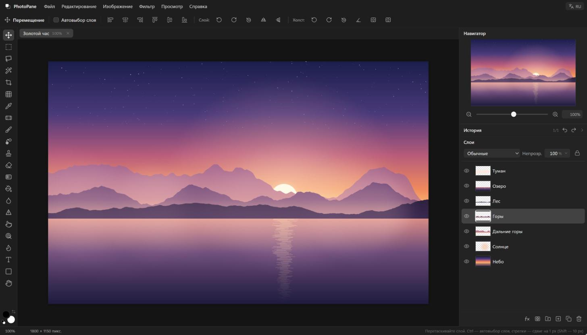
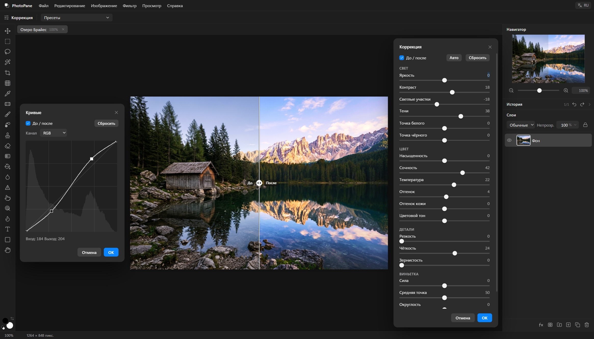

<p align="center">
  
</p>

<h1 align="center">PhotoPane</h1>

<p align="center">
  Лёгкий современный редактор изображений для Windows, macOS и Linux.<br>
  Привычные инструменты — без перегруженного интерфейса.
</p>

<p align="center">
  <a href="https://github.com/sokoloff-rv/photopane/releases/latest"><b>Скачать</b></a> ·
  <a href="README.md">English</a>
</p>



PhotoPane закрывает всё, ради чего обычно запускают тяжёлый фоторедактор: быстро поправить свет и цвет, отретушировать снимок, вырезать объект, собрать композицию из слоёв или добавить текст — без лишнего веса и запутанных меню. Он открывает файлы Photoshop со слоями, работает полностью офлайн, а установщик для Windows и macOS весит всего около 18 МБ. Ваши изображения остаются на компьютере и никуда не отправляются, пока вы сами не запустите облачный ИИ со своим API-ключом.

## Почему PhotoPane

- **Лёгкий и полностью офлайн:** установщик около 18 МБ на Windows и macOS, быстрый запуск, работа со слоями и файлами `.psd`, без учётной записи и подписок.
- **Живая цепочка коррекций на GPU:** можно открыть сразу несколько окон коррекций и фильтров — они складываются в общую цепочку с разделителем «до / после» и плавно обсчитываются на видеокарте.
- **Локальная ретушь и апскейл без облаков:** заливка с учётом содержимого и встроенное 2×/4× увеличение разрешения работают прямо на вашем компьютере.
- **Настоящее сравнение версий:** окно делится на две независимые копии документа со всей историей, общим масштабом и выравниванием размера после апскейла.
- **Опциональный и прозрачный ИИ:** собственные API-ключи Stability AI и Topaz Labs подключаются только при желании; редактор заранее проверяет ограничения, показывает остаток на ключах и цену операции до запуска, а также ведёт локальный учёт расходов.

## Что умеет

**Слои и типографика.** Группы, маски слоя, обтравочные маски, 17 режимов наложения, непрозрачность и закрепление прозрачных пикселей. Неразрушающие стили слоя — тень, обводка, тиснение, наложение цвета и градиента — автоматически подстраиваются под любые правки. Свободное трансформирование поддерживает искажение и перспективу, а текст остаётся редактируемым с системными шрифтами и Google Fonts.

**Свет и цвет.** Главное окно **«Коррекция»** объединяет настройки света, цвета, оттенка кожи, чёткости, зернистости и виньетки — с кнопкой «Авто» и собственными пресетами. Для более тонкой работы есть «Уровни», «Кривые», HSL-микшер и тонирование. Все изменения видны прямо на холсте по мере движения ползунков, а несколько окон можно держать открытыми одновременно.



**Ретушь.** Убирайте лишние детали точечной восстанавливающей кистью, штампом или локальной заливкой с учётом содержимого — достаточно выделить объект, и редактор сам достроит фон из окружающей текстуры прямо на вашем компьютере. Также есть кисти размытия, резкости, «палец», осветлитель, затемнитель и замена цвета.

**Фильтры.** Размытие по Гауссу, в движении, радиальное и по поверхности, а также размытие поля, диафрагмы и наклон-смещение с бликами боке — зону фокуса можно настраивать ручками прямо на снимке. Контурная резкость, удаление дымки, шумоподавление, свечение, полутоновый растр, тиснение, 3D-LUT (`.cube`) и другие фильтры поддерживают шторку «до / после», а тяжёлые расчёты ускоряются на видеокарте.


**Выделение и кадрирование.** Прямоугольник и эллипс, обычное, прямолинейное и магнитное лассо (с правкой поставленных точек через Ctrl), волшебная палочка — плюс растушёвка, расширение, сжатие и сглаживание. Кадрирование поддерживает свободный формат, стандартные пропорции, точные размеры в пикселях, свои наборы и кадрирование перспективы; если вытянуть рамку за границы холста, новое поле можно заполнить цветом, локально с учётом содержимого или через ИИ.

**Сравнение.** Разделите рабочую область на две независимые копии документа со всей историей: откатите одну сторону назад или обработайте иначе и сравните оба варианта рядом с синхронным масштабом.


**Файлы и цветовые профили.** Открывает PNG, JPEG, WebP, GIF, BMP, AVIF и PSD. Сохраняет PSD со слоями, масками, стилями и редактируемым текстом, а при экспорте в JPEG, PNG, WebP и PDF сразу показывает итоговый размер файла по мере выбора качества. Есть пакетная обработка целых папок и поддержка профилей sRGB, Display P3 и Adobe RGB.

**ИИ — когда он действительно нужен.** Увеличение разрешения в 2× или 4× встроенной локальной моделью без интернета или через Topaz Labs и Stability AI с вашими API-ключами (подходящую модель Topaz редактор подбирает под снимок сам). Доступны удаление фона на неразрушающую маску, выделение объекта и дорисовка при кадрировании — с предварительной проверкой ограничений, остатком на ключах, показом цены при вызове и локальным учётом расходов.

**Встроенное обучение.** Откройте **Справка → Обучение** (`F1`) — там понятным языком описаны все инструменты, коррекции и фильтры, работает поиск, а само окно можно держать открытым рядом с холстом прямо во время работы.


Интерфейс доступен на русском и английском языках, а горячие клавиши совпадают с привычными по Photoshop.

## Скачать

Свежую версию можно скачать на странице [Releases](https://github.com/sokoloff-rv/photopane/releases/latest):

| Система | Файл |
| --- | --- |
| Windows 10 и 11 | `…-setup.exe` (установщик) или `.msi` |
| macOS 11 и новее (Apple Silicon и Intel) | `.dmg` |
| Linux | `.deb`, `.rpm` или `.AppImage` |

- **Windows:** установщик пока не подписан коммерческим сертификатом, поэтому при первом запуске Windows SmartScreen может показать окно *«Система Windows защитила ваш компьютер»*. Нажмите **«Подробнее» → «Выполнить в любом случае»** — это понадобится только один раз.
- **macOS:** приложение пока не нотаризовано в Apple. При первом запуске зайдите в **Системные настройки → Конфиденциальность и безопасность** и нажмите **«Всё равно открыть»** рядом с уведомлением о PhotoPane — тоже один раз.

## Приватность

PhotoPane не требует учётной записи и не собирает никаких данных или телеметрии. Все изображения открываются, редактируются и сохраняются локально на вашем компьютере. Шрифты Google Fonts загружаются только при первом выборе конкретного шрифта. Облачные ИИ-функции (Stability AI и Topaz Labs) отправляют текущее изображение с вашим API-ключом исключительно по вашей команде, а сами ключи хранятся только на вашем устройстве.

<details>
<summary><b>Сборка из исходников</b></summary>

PhotoPane написан на чистом TypeScript без UI-фреймворков с использованием Canvas 2D, шейдеров WebGL2, Web Workers, ONNX Runtime Web (для локального апскейла) и [Tauri 2](https://v2.tauri.app/) в качестве нативной оболочки — благодаря этому десктопная сборка весит около 18 МБ.

**Требования:** Node.js 22+ (а для десктопной сборки — также Rust 1.77+ и системные зависимости Tauri).

```bash
npm install
npm run dev            # запустить веб-версию на http://localhost:5178
npm run desktop        # запустить десктопное приложение Tauri в dev-режиме
npm run desktop:build  # собрать установочные пакеты
```

</details>

## Лицензия

PhotoPane — свободная программа: её можно использовать, изучать, изменять и распространять на условиях
[GNU Affero General Public License v3.0](LICENSE) или любой более поздней версии. Всё, что сделано на основе
PhotoPane и распространяется — как десктопная программа или как сервис по сети, — должно выходить под той же
лицензией вместе с исходным кодом.
