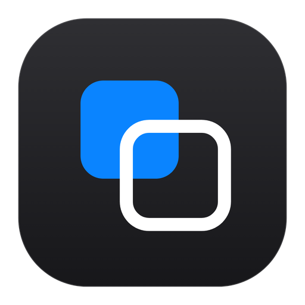
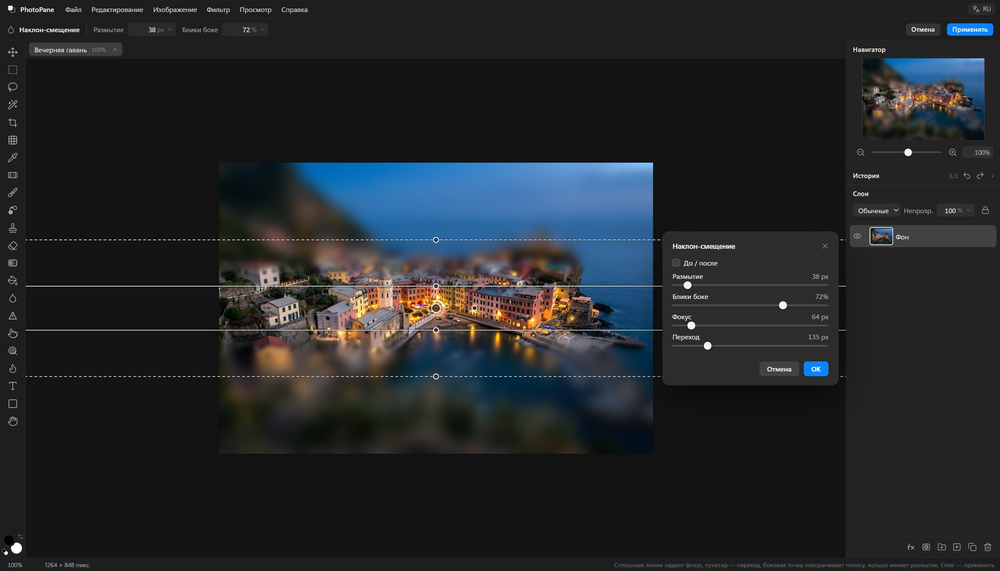
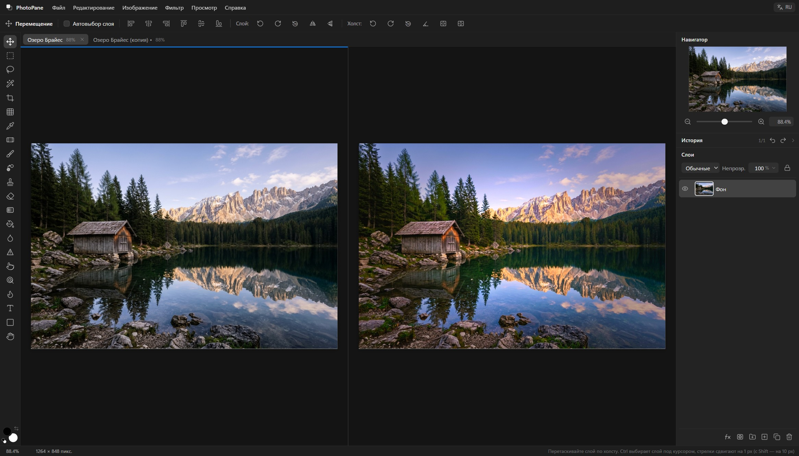
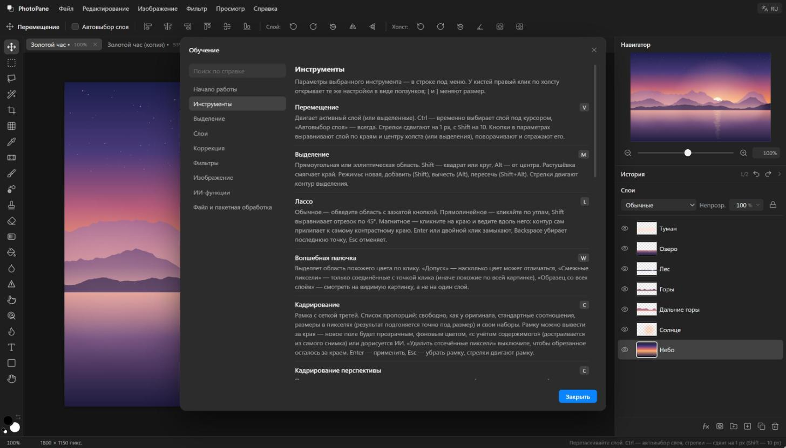

  

<h1 align="center">PhotoPane</h1>

  Лёгкий современный редактор изображений для Windows, macOS и Linux. 
  Привычные инструменты — и у каждого действия один очевидный путь.

  <a href="https://github.com/sokoloff-rv/photopane/releases/latest"><b>Скачать</b></a> ·
  <a href="README.md">English</a>

PhotoPane делает то, ради чего обычно открывают большой фоторедактор: поправить свет и цвет, отретушировать,
вырезать, собрать картинку из слоёв, добавить текст — без лишнего веса и нагромождения. Он открывает файлы Photoshop
со слоями, работает без интернета, а установщик для Windows и macOS весит около 18 МБ. Ваши картинки не покидают
компьютер, пока вы сами не попросите ИИ-сервис помочь со своим ключом.

## Что умеет

**Слои.** Группы, маски слоя, обтравочные маски, 17 режимов наложения, непрозрачность и закрепление прозрачных
пикселей. Стили слоя: тень, обводка, тиснение, наложение цвета и градиента. Свободное трансформирование с искажением
и перспективой. Текст остаётся редактируемым.

**Свет и цвет.** Одно окно «Коррекция» — свет, цвет, оттенок кожи, чёткость, зернистость и виньетка, с кнопкой
«Авто» и своими пресетами, — а также «Уровни», «Кривые», HSL-микшер и тонирование. Результат виден на картинке сразу,
пока двигаете ползунки, и несколько окон можно держать открытыми одновременно.

**Ретушь.** Точечная восстанавливающая кисть, штамп и заливка с учётом содержимого: выделите лишнее — и область
соберётся из окружающей картинки прямо на вашем компьютере. Кисти размытия, резкости и «палец», осветлитель и
затемнитель, замена цвета.

**Фильтры.** Размытие по Гауссу, в движении, радиальное и по поверхности, а также размытие поля, диафрагмы и
наклон-смещение с бликами боке — с ручками прямо на снимке. Контурная резкость, удаление дымки, шумоподавление,
свечение, полутоновый растр, тиснение, цветовые LUT (.cube) и другие — со шторкой «до / после». Тяжёлые расчёты
идут на видеокарте.

**Выделение.** Прямоугольник и эллипс, обычное, прямолинейное и магнитное лассо, волшебная палочка; растушёвка,
расширение, сжатие и сглаживание.

**Кадрирование.** Пропорции, точные размеры в пикселях и свои наборы, кадрирование перспективы. Выведите рамку за
края — новое поле заполнится цветом, из самого снимка или с помощью ИИ.

**Сравнение.** Окно делится на две независимые копии документа: откатите одну в истории или обработайте иначе — и
смотрите обе рядом.

**Файлы.** Открывает PNG, JPEG, WebP, GIF, BMP, AVIF и PSD. Сохраняет PSD со слоями, масками и текстом; экспортирует
в JPEG, PNG, WebP и PDF и сразу показывает размер файла при выборе качества. Пакетная обработка многих файлов сразу.
Цветовые профили: sRGB, Display P3, Adobe RGB.

**ИИ — если нужен.** Увеличение в 2× или 4× локальной моделью без интернета или через Topaz Labs и Stability AI с
вашими ключами (модель Topaz PhotoPane подбирает под снимок сам). Удаление фона, выделение объекта, дорисовка нового
поля при кадрировании. Перед отправкой PhotoPane проверяет, подходит ли картинка, и прямо говорит, если нет. Видно,
сколько осталось на каждом ключе, сколько стоит операция при её вызове и сколько кредитов потратил сам PhotoPane.

**Учиться по ходу дела.** Справка → «Обучение» (F1) в нескольких строках объясняет каждый инструмент, коррекцию и
фильтр, с поиском, в окне, которое можно держать открытым рядом с работой.

Интерфейс на русском и английском, горячие клавиши — те же, что в Photoshop.

## Скачать

Последняя версия — на странице [Releases](https://github.com/sokoloff-rv/photopane/releases/latest):

| Система | Файл |
| --- | --- |
| Windows 10 и 11 | `…-setup.exe` (установщик) или `.msi` |
| macOS 11 и новее, Apple Silicon и Intel | `.dmg` |
| Linux | `.deb`, `.rpm` или `.AppImage` |

На macOS приложение пока не заверено Apple. При первом запуске macOS попросит подтверждение: откройте
**Системные настройки → Конфиденциальность и безопасность** и нажмите **«Всё равно открыть»** у сообщения о
PhotoPane. Это нужно сделать один раз.

## Приватность

У PhotoPane нет учётной записи, и он не собирает никаких данных. Картинки открываются и сохраняются на вашем
компьютере. Шрифты Google Fonts скачиваются при первом выборе. ИИ-функции, которые работают через Stability AI или
Topaz Labs, отправляют в сервис картинку, с которой вы работаете, с вашим ключом и только когда вы их запускаете;
ключи хранятся только на вашем компьютере.
